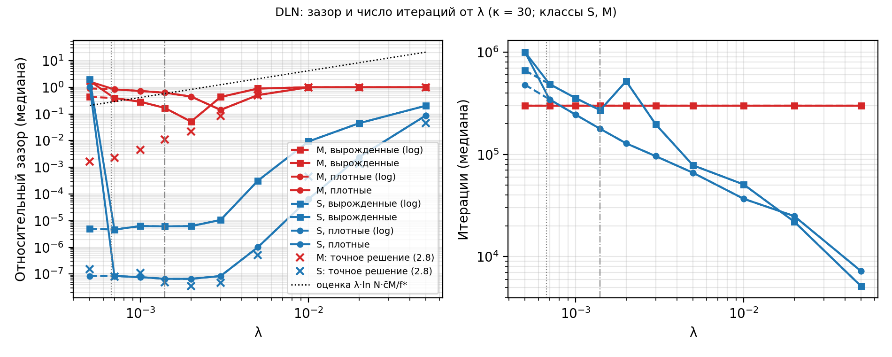

УДК 519.852

# СИМПЛЕКС-МЕТОД, МЕТОД ВНУТРЕННЕЙ ТОЧКИ И ДИАГОНАЛЬНАЯ ЛИНЕЙНАЯ СЕТЬ В ЗАДАЧАХ РАСПРЕДЕЛЕНИЯ РЕСУРСОВ

**К. В. Олешкевич**

_Белорусский государственный университет, Минск, Беларусь, e-mail_

На 570 сгенерированных задачах распределения ресурсов размером до 1000×2000 сравниваются табличный симплекс-метод с правилами Данцига и Бланда, метод внутренней точки Мехротры и градиентный спуск в диагональной линейной сети (DLN). Симплекс-метод с правилом Данцига точен и быстрее остальных. DLN на малых задачах даёт медианный зазор 4,5·10⁻⁶, но у 24 % задач он выше 10⁻³; на больших смещение энтропийной регуляризации требует λ ниже предела арифметики double.

**Ключевые слова:** линейное программирование; распределение ресурсов; симплекс-метод; метод внутренней точки; диагональная линейная сеть; энтропийная регуляризация.

## Введение

Задача распределения ресурсов $\max\{c^\top x:\ Ax\le b,\ x\ge 0\}$ с $A\ge 0$, $b>0$, $c>0$ — базовая модель
планирования производства. Классические методы её решения — симплекс-метод и методы внутренней точки.
В 2023 г. предложен подход на основе нейронной сети [1]: градиентный спуск по параметрам диагональной
линейной сети (DLN, $x=u\circ u$) неявно решает энтропийно регуляризованную задачу ЛП, а сила регуляризации
задаётся масштабом инициализации. Эвристики вроде генетических алгоритмов не гарантируют оптимальности и
здесь не рассматриваются. Цель работы — воспроизводимо сравнить точность и время этих подходов на одном
классе задач и выяснить, где DLN применим на практике.

## Методы

_Симплекс-метод_ — табличный, из базиса слэков. Правило Данцига вводит в базис столбец с наименьшей
приведённой стоимостью, правило Бланда — первый по номеру подходящий столбец [2]; выводимая строка
в обоих случаях выбирается по минимальному отношению. _Метод внутренней точки_ — прямо-двойственный
предиктор-корректор Мехротры [3] с разложением Холецкого нормальных уравнений.

_DLN._ Задача сводится к виду $\min\{\hat{c}^\top z:\ \hat{A}z=\hat{b},\ z\ge 0\}$, которого требует [1]. Для этого
добавляются слэки $s$ и ограничение $\mathbf{1}^\top x+\mathbf{1}^\top s+t=M$ с заведомо неактивной константой
$M=1{,}1\,\min\bigl\{\sum_j\min_{i:a_{ij}>0} b_i/a_{ij}+\sum_i b_i,\ \gamma\sum_i b_i\bigr\}$,
$\gamma=\max(1,1/\min_j\sum_i a_{ij})$.
Переменные делятся на $M$, строки нормируются, стоимости $\hat{c}_x=1-c_j/\max c$, $\hat{c}_s=\hat{c}_t=1$
лежат в $[0,1]$. Итерация [1]:

$$
u^{k+1}=u^k\circ\bigl(\mathbf{1}-2\eta_k\hat{A}^\top r^k\bigr),\quad
r^k=\hat{A}(u^k\circ u^k)-\hat{b},\quad
u_j^0=\alpha\,e^{-\hat{c}_j/(2\lambda)},
$$

$$
\eta_k=\min\Bigl\{\frac{1}{4\lVert\hat{A}^\top r^k\rVert_\infty},\;
\frac{\kappa}{5L\lVert u^k\rVert_\infty^2}\Bigr\},\qquad
L=\lVert\hat{A}\rVert_2^2.
$$

При $\kappa=1$ и $\eta\to 0$ предел $z_\lambda=u^\infty\circ u^\infty$ решает задачу
$\min\{\hat{c}^\top z+\lambda\sum_j(z_j\ln z_j-z_j):\ \hat{A}z=\hat{b},\ z\ge0\}$ [1]. Поскольку $\mathbf{1}^\top z=1$,
смещение оценивается через $\lambda\ln N$, $N=n+m+1$; в исходных единицах относительный зазор не превышает
$\lambda\ln N\cdot M c_{\max}/\max(1,|f^\star|)$. Множитель $Mc_{\max}\ln N/f^\star$ на плотных задачах равен примерно 33, 784,
5700 и 12 800 для S, M, L и XL: $M\propto\sum_j U_j$ растёт с $n$, а оптимум $f^\star$ с малым носителем отстаёт. Поэтому
часть проигрыша DLN создаёт грубая редукция с большим $M$, и вывод о неконкурентности DLN условен относительно неё. Точная константа экспоненциальной сходимости при
$\lambda\to0$ дана в [4]. Шаг с $\kappa>1$ ускоряет спуск, но добавляет смещение порядка $\eta$ [1]. Есть и
машинное ограничение: при $\lambda<1{,}4\cdot10^{-3}$ начальные $x_j^0$ становятся денормализованными
(арифметика с ними на x86 в десятки раз медленнее), а при $\lambda<6{,}7\cdot10^{-4}$ $u_j^0$ обращается в ноль
и координата «замерзает». Вариант с хранением $\ln u$ снимает только второй эффект.

## Методика эксперимента

Генератор детерминирован (зерно задаётся набором, классом, структурой и номером, SHA-256 каждого файла в
манифесте). Классы $m\times n$: S 10×20 (100 задач на структуру), M 100×200 (50), L 500×1000 (30),
XL 1000×2000 (10). Структуры: плотная ($a_{ij}\sim U[0{,}1;1]$), разреженная (8 % ненулей) и вырожденная
(целые $a_{ij}\in\{0,1,2\}$, половина ограничений активна в построенной точке). Эталон $f^\star$ получен
HiGHS [5] двумя методами (двойственный симплекс; IPM с crossover); берётся решение с лучшим
прямо-двойственным сертификатом, его невязки и разрыв двойственности не превышают $10^{-12}$.

Все методы реализованы на C# (.NET 10, Native AOT, SIMD 256 бит). Решатели запускались последовательно,
каждый в одном потоке на выделенном ядре (процесс закреплялся за ядром). Сравниваются сами алгоритмы в
равных условиях, поэтому из замеров исключены факторы, зависящие от окружения и искажающие время. При
параллельном решении независимых задач процессы делят кэш последнего уровня, пропускную способность
памяти и тепловой бюджет, а при SMT — ещё и исполнительные блоки одного физического ядра; методы при
этом замедляются неодинаково (пивот симплекса по плотной таблице упирается в память, разложение
Холецкого в IPM в большей степени вычислительное), и время зависело бы от порядка и состава одновременных
задач, а не от метода. Точность, число итераций и статусы от параллельности не зависят, поэтому
ограничение относится только к времени; последовательный режим сохраняет смысл таймаутов и делает
сравнение воспроизводимым на другой машине, а не только при той же загрузке системы.

Замеры: облачная ВМ (Intel Xeon с AVX-512, 4 vCPU, Ubuntu 24.04), время — медиана 5 повторов после
разогрева (на XL и для DLN начиная с M — один замер). Лимиты: симплекс — $50(2m+n)$ пивотов, IPM — 100 итераций при допуске $10^{-8}$, DLN — остановка по
$\|\hat A z-\hat b\|_2/\|\hat b\|_2\le10^{-8}$ или $10^6/3\cdot10^5/2\cdot10^4/5\cdot10^3$ итераций для S/M/L/XL.
Параметры DLN ($\lambda=5\cdot10^{-3}$ для S и $3\cdot10^{-3}$ для остальных, $\kappa=30$) выбраны по заранее
зафиксированному правилу на отдельном обучающем наборе. Метрики: относительный зазор
$|f-f^\star|/\max(1,|f^\star|)$, невязка ограничений, статус. Код, генератор и скрипты запуска для Windows и
Linux/macOS доступны в репозитории проекта; полный прогон повторяется одной командой.

## Результаты

Оба варианта симплекс-метода совпали с эталоном с точностью $3\cdot10^{-13}$ на всех решённых задачах,
IPM решил все 570 задач с зазором не более $1{,}3\cdot10^{-8}$ (табл. 1).

Таблица 1 — Медианы по задачам класса (все структуры): время, мс (итерации); для DLN — также зазор

| Класс | Данциг      | Бланд            | IPM       | DLN           | Зазор DLN           |
| ----- | ----------- | ---------------- | --------- | ------------- | ------------------- |
| S     | 0,0017 (7)  | 0,0028 (14)      | 0,024 (8) | 12,6 (43 628) | $4{,}5\cdot10^{-6}$ |
| M     | 0,73 (123)  | 7,7 (1442)       | 4,3 (13)  | 2887 (лимит)³ | $0{,}13$            |
| L     | 396 (2102)  | 12 088 (63 539)¹ | 857 (19)  | 6566 (лимит)³ | $1{,}0$             |
| XL    | 5502 (6800) | 157 204 (лимит)² | 9047 (22) | 6895 (лимит)³ | $0{,}98$            |

¹ 3 % задач — лимит пивотов. ² 67 % задач (все разреженные и вырожденные) — лимит пивотов. ³ Время DLN — время до исчерпания лимита итераций, а не до решения; с решёнными временами не сопоставляется.

_Симплекс-метод._ Правило Данцига быстрее остальных методов почти на всех задачах. Времена на S (около 1,7 мкс) шумны (отношение max/min повторов в среднем около 8), поэтому различие Данцига и Бланда на S лежит
в пределах шума; устойчиво только сравнение с IPM. Разрыв с IPM велик на
плотных задачах (в 21–36 раз начиная с M) и сокращается на разреженных и вырожденных XL до 1,3–1,4 раза.
Правило Бланда требует больше пивотов: в 1,3–2,3 раза на S, в 7–11 раз на M и в 24–32 раза на L и XL.
Вырожденные пивоты встретились только на вырожденных задачах S (14–16 %): вырожденность оптимальной
вершины не порождает вырожденных шагов на пути из базиса слэков. _IPM_ сходится за 8–22 итерации, число
итераций растёт примерно как логарифм размера, но итерация стоит $O(m^3)$, и на XL медианное время IPM в
1,6 раза выше, чем у симплекса по Данцигу.

_DLN._ Итерация DLN стоит как 1,7 пивота плотной таблицы (0,33 и 0,19 мс на L), однако уже на S итераций
нужно в тысячи раз больше. На S критерий остановки (малая невязка ограничений) выполнен в 92 % задач, но он не гарантирует точность по целевой функции:
зазор — медиана $4{,}5\cdot10^{-6}$, квантили p75 $7{,}9\cdot10^{-4}$, p90 $6{,}5\cdot10^{-3}$, p95 $1{,}2\cdot10^{-2}$; зазор $\le10^{-3}$
у 76 % задач, а 68 из 276 «решённых» задач его превышают. Начиная с M лимит итераций исчерпан во всех задачах, медианный зазор по структурам —
от 0,02 до 3. Причина не только в лимите, что видно из эксперимента по $\lambda$ (рис. 1, по 20 задач S и M).
Вывод о смещении опирается на точное решение регуляризованной задачи только для 5 плотных задач M (для L и XL такой проверки
нет, там он остаётся оценкой по формуле выше): оно отстоит от оптимума на 50 % при
$\lambda=5\cdot10^{-3}$, на 8 % при $3\cdot10^{-3}$ и на 0,2 % лишь при $5\cdot10^{-4}$, то есть за пределом, где в
double обнуляется $u^0$. На S оно точнее $10^{-6}$ уже при $\lambda\le5\cdot10^{-3}$, а число итераций растёт
примерно как $1/\lambda$. Кривая зазора на M имеет минимум при $\lambda\approx2$–$3\cdot10^{-3}$: справа доминирует
регуляризация, слева — недоитерированность. При $\lambda=5\cdot10^{-4}$ обычный вариант даёт зазор больше 1,
вариант с $\ln u$ продолжает гладкую кривую. В зоне денормалов ($7\cdot10^{-4}$–$10^{-3}$) время итерации на M
выросло в 2,4–4,5 раза.

_Шаг $\kappa$._ Параметр $\kappa=30$ выбран на обучающем наборе ради скорости, но влияет на точность (табл. 2, класс S, $\lambda=5\cdot10^{-3}$).
На иллюстративной задаче (3×4, $f^\star=150$) при $\kappa=30$ статус «решено» сопровождается зазором 49 %, при $\kappa=10$ зазор
$3\cdot10^{-2}$, при $\kappa=3$ — $2\cdot10^{-5}$, при $\kappa=1$ — $10^{-6}$ (симплекс и IPM дают 150 за 2–7 итераций).
Меньшие $\kappa$ точнее, но требуют больше итераций и чаще упираются в лимит; $\kappa=10$ даёт лучшие квантили на S, поэтому
точность DLN на S частично определяется выбором $\kappa$.

Таблица 2 — DLN на классе S в зависимости от $\kappa$

| $\kappa$ | Решено | Зазор: медиана | p90 | Зазор $\le10^{-3}$ | Итерации (мед.) |
| -------- | ------ | -------------- | --- | ------------------ | --------------- |
| 1        | 41 %   | $2{,}8\cdot10^{-4}$ | $3{,}4\cdot10^{-2}$ | 60 % | 1 000 000 |
| 3        | 72 %   | $1{,}6\cdot10^{-5}$ | $4{,}2\cdot10^{-3}$ | 79 % | 451 673 |
| 10       | 86 %   | $3{,}7\cdot10^{-6}$ | $2{,}2\cdot10^{-3}$ | 83 % | 133 498 |
| 30       | 92 %   | $4{,}5\cdot10^{-6}$ | $6{,}5\cdot10^{-3}$ | 76 % | 43 628 |

Рисунок 1 — Медианный зазор (слева) и число итераций (справа) DLN в зависимости от $\lambda$, $\kappa=30$;
крестики — точное решение регуляризованной задачи, вертикальные линии — $1{,}4\cdot10^{-3}$ и $6{,}7\cdot10^{-4}$

## Заключение

На задачах распределения ресурсов до 1000×2000 табличный симплекс-метод с правилом Данцига точен и
быстрее метода внутренней точки; это верно в условиях задачи: $A\ge0$, $b>0$ (фаза 1 не нужна), малый носитель оптимума, IPM не
использует разреженность матрицы. Правило Бланда гарантирует конечность ценой роста числа пивотов в
десятки раз. Метод внутренней точки стабилен по числу итераций и приближается к симплексу на разреженных
задачах. DLN использует только матрично-векторные произведения, но на этом классе задач неконкурентен:
энтропийное смещение растёт с размером, а необходимые $\lambda$ выходят за пределы double, где также
резко замедляется арифметика. DLN может рассматриваться для небольших задач распределения ресурсов, где
допустима энтропийная регуляризация и ручной выбор $\lambda$ и $\kappa$, а также в связке с градиентными
моделями; для типовых производственно-экономических расчётов среднего и большого размера с требованием
точного или сертифицированного оптимума практическая целесообразность DLN низкая — классический симплекс
и промышленные решатели остаются предпочтительными. Ограничения работы: одна вычислительная платформа (облачная ВМ),
плотная таблица вместо модифицированного симплекса, конечные лимиты итераций DLN. Скрипты позволяют
повторить замеры на других процессорах.

## Список литературы

1. Wang, H. Linear programming using diagonal linear networks [Электронный ресурс] / H. Wang, P. Ghosal, R. Mazumder. – 2023. – arXiv:2310.02535. – Режим доступа: https://arxiv.org/abs/2310.02535. – Дата доступа: 15.10.2026.
2. Bland, R. G. New finite pivoting rules for the simplex method / R. G. Bland // Mathematics of Operations Research. – 1977. – Vol. 2, № 2. – P. 103–107.
3. Mehrotra, S. On the implementation of a primal-dual interior point method / S. Mehrotra // SIAM Journal on Optimization. – 1992. – Vol. 2, № 4. – P. 575–601.
4. Weed, J. An explicit analysis of the entropic penalty in linear programming / J. Weed // Proceedings of the 31st Conference on Learning Theory. – 2018. – Vol. 75. – P. 1841–1855.
5. Huangfu, Q. Parallelizing the dual revised simplex method / Q. Huangfu, J. A. J. Hall // Mathematical Programming Computation. – 2018. – Vol. 10, № 1. – P. 119–142.
